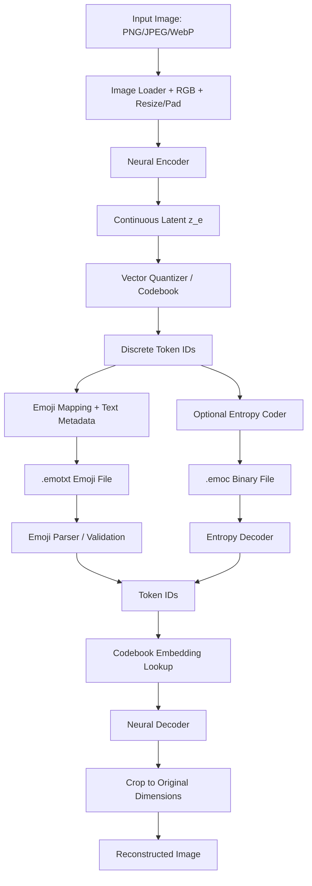

# EmoCodec — Emoji-Based Neural Image Codec

> **เอกสาร Technical Specification + Tech Stack + Implementation Roadmap**  
> เวอร์ชัน: 1.0 | วันที่: 10 ตุลาคม 2026 | สถานะ: Proposed / Research Prototype

## 0. Executive Summary

**EmoCodec** คือระบบเข้ารหัสและถอดรหัสภาพแบบ *lossy neural image compression* โดยใช้ **Emoji เป็นรูปแบบแสดงผลของรหัสดิจิทัล (discrete token IDs)** ที่ได้จากโมเดล ไม่ใช่การแปลงวัตถุในรูปเป็นอิโมจิตามความหมาย

ตัวอย่าง: `🐸` อาจแทนรหัส `42` ซึ่งอ้างถึงเวกเตอร์ใน codebook ที่อาจเป็นลักษณะขอบ แสง เงา texture หรือรูปแบบผสมที่มนุษย์ตีความไม่ได้โดยตรง ส่วน `🌊` ไม่จำเป็นต้องหมายถึงน้ำ

**เป้าหมายหลัก**

1. `image → encoder → quantized token IDs → emoji text` และย้อนกลับ `emoji text → IDs → decoder → reconstructed image`
2. Decoder ต้อง **ถอดรหัสชุดเดิมได้ซ้ำอย่างกำหนดแน่นอน (deterministic ภายใต้ runtime/weights ที่ควบคุม)** โดยไม่ต้องอาศัยภาพต้นฉบับ
3. ลดข้อมูลภาพโดยยอมให้คุณภาพสูญเสียอย่างควบคุมได้และเปรียบเทียบผลเชิงปริมาณได้จริง
4. มี **2 รูปแบบการส่งออก**: Emoji Text สำหรับแสดง/คัดลอก และ Binary Codec สำหรับขนาดข้อมูลที่มีประสิทธิภาพ
5. พัฒนาเป็น prototype ที่ทดสอบเชิงวิจัยได้ โดยมี baseline เทียบ JPEG, WebP, AVIF ที่ bit rate ใกล้กัน

**สิ่งที่ไม่ใช่**: ไม่ใช่ ZIP, ไม่ใช่ lossless codec โดยค่าเริ่มต้น และการใช้อิโมจิไม่ได้ทำให้การบีบอัดดีขึ้นโดยตัวมันเอง — ประสิทธิภาพมาจาก encoder, quantization และ entropy coding

---

## 1. หลักการและข้อจำกัดสำคัญ

### 1.1 Emoji คือ token ไม่ใช่ semantic label

- Encoder เรียนรู้ latent representation ของภาพ
- Quantizer จับคู่เวกเตอร์ latent กับ embedding ใน **codebook**
- ได้ integer token ID เช่น `0..255`
- Presentation layer จับคู่ `ID ↔ emoji` แบบ **หนึ่งต่อหนึ่ง (bijection)** โดยใช้ตารางที่ตรึงเวอร์ชันแล้ว
- Decoder ใช้ **ID และ codebook embedding** เพื่อ reconstruct ภาพ ไม่จำเป็นต้องมองเห็นรูป Emoji

ตัวอย่างสมมุติ:

```text
Image
  ↓
Encoder
  ↓
Latent grid (16×16×128)
  ↓
VQ codebook lookup (K=256, D=128)
  ↓
Token IDs [42, 7, 98, 42, ...]
  ↓ emoji presentation mapping
🐸🦊🍄🐸...
  ↓ reverse emoji mapping
Token IDs [42, 7, 98, 42, ...]
  ↓ codebook embedding lookup
Decoder
  ↓
Reconstructed image
```

### 1.2 ขนาดข้อมูลจริงเป็นอย่างไร

สมมุติภาพต้นฉบับ 256×256 RGB, encoder downsample 16 เท่าในแต่ละแกน:

- latent grid: `16×16 = 256 IDs`
- codebook size: `256 entries` → แต่ละ ID มี 8 บิต
- **packed ID payload = 256 bytes** (ยังไม่รวม header)
- Emoji Text ที่ใช้ code point UTF-8 ขนาด 4 bytes ต่อตัวโดยประมาณ → **1,024 bytes** สำหรับ 256 Emoji (ก่อน header)
- ภาพ RGB แบบดิบ = `256×256×3 = 196,608 bytes`

ตัวเลขนี้ **เป็นตัวอย่างของ payload เท่านั้น** ไม่ได้บอกคุณภาพภาพ, ขนาดโมเดล, ค่าโครงสร้างข้อมูล, หรือรับประกันว่าเหนือกว่า JPEG/WebP/AVIF

> **ข้อสรุปทางวิศวกรรม**: หากเป้าหมายคือไฟล์เล็ก ใช้ `.emoc` แบบ binary; หากเป้าหมายคือข้อมูลน่าสนใจ/แชร์เป็น Emoji ใช้ `.emotxt` แต่เก็บข้อมูลเดียวกันและใช้ Decoder เดียวกัน

### 1.3 Decoder จำเป็นต้องมี shared model

ทั้งสองฝั่งต้องใช้ **model weights + codebook + token mapping ที่ตรงเวอร์ชัน** หากใช้ weights ต่างกันภาพที่ได้จะผิดไป แม้ลำดับ emoji เหมือนกัน และขนาด weights ไม่ควรถูกละเลยหากผู้รับต้องดาวน์โหลดเพื่อถอดรหัสเพียงภาพเดียว

### 1.4 ประเด็นที่ต้องแยกให้ชัด

| เรื่อง | สิ่งที่ทำได้ | ข้อจำกัด |
|---|---|---|
| Round-trip ของ Emoji → ID → Emoji | คืนตัวอักษรเดิม 100% หากข้อความไม่ถูกเปลี่ยน | แอปแชตบางตัวอาจปรับอักขระ/selector |
| Image → Emoji → Image | สร้างภาพกลับได้ | ภาพอาจไม่เหมือนเดิมระดับพิกเซล |
| ลดจำนวน Emoji | ลดจำนวน code IDs ได้ | ภาพมักสูญเสียข้อมูลมากขึ้น |
| AI เพิ่มรายละเอียด | ภาพอาจดูดีขึ้น | บางรายละเอียดอาจถูกสร้างขึ้นใหม่ |
| Lossless 100% | ทำได้หากเพิ่ม residual แบบ lossless ครบ | โดยทั่วไปต้องใช้ข้อมูลเพิ่ม และเป็นคนละเป้าหมายกับ MVP |

---

## 2. Architecture: End-to-End



**Invariant ที่ต้องผ่านเสมอ**: decoded token IDs จาก text และ binary ต้องเหมือนกันทุกตำแหน่ง เมื่อเริ่มจากชุด IDs เดียวกัน

### 2.1 Neural Encoder

MVP เริ่มด้วย **Convolutional VQ-VAE** เพราะเข้าใจง่าย ฝึกง่ายกว่าโมเดลขนาดใหญ่ และตรวจสอบข้อมูลระหว่างทางได้

รูปแบบตัวอย่าง (256×256 RGB → 16×16 latent):

```text
Input                 [B, 3, 256, 256]
Conv stride=2         [B, 64, 128, 128]
Conv stride=2         [B, 128, 64, 64]
Conv stride=2         [B, 128, 32, 32]
Conv stride=2         [B, 128, 16, 16]
Residual blocks       [B, 128, 16, 16]
1×1 Conv              [B, 128, 16, 16]  → z_e
```

**หมายเหตุ**: Shape และจำนวน layer เป็นค่าตั้งต้นสำหรับการทดลอง ไม่ใช่ optimum

### 2.2 Vector Quantization (VQ)

ตั้ง codebook เป็น `E ∈ R^(K×D)` เช่น `K=256`, `D=128`

สำหรับเวกเตอร์ latent `z_e(i,j)` เลือก ID ที่มีระยะใกล้สุด:

`index(i,j) = argmin_k || z_e(i,j) - E[k] ||²`

จากนั้นแทน latent ด้วย `E[index(i,j)]` ก่อนเข้า decoder

**Loss พื้นฐานของ VQ-VAE**:

```text
L_total = L_reconstruction
        + || sg[z_e] - e ||²          # codebook loss
        + β || z_e - sg[e] ||²        # commitment loss
```

โดย `sg` คือ stop-gradient และ `β` เป็น hyperparameter เช่นเริ่มทดลองที่ `0.25` (ปรับจาก validation)

เลือกใช้ straight-through estimator หรือ EMA codebook update (ระบุหนึ่งแบบชัดเจนต่อ experiment)

### 2.3 Neural Decoder

```text
Token IDs             [B, 16, 16]
Codebook lookup       [B, 128, 16, 16]
Residual blocks       [B, 128, 16, 16]
Upsample ×2           [B, 128, 32, 32]
Upsample ×2           [B, 128, 64, 64]
Upsample ×2           [B, 64, 128, 128]
Upsample ×2           [B, 32, 256, 256]
Output Conv           [B, 3, 256, 256]
Clamp [0,1]          Reconstructed RGB
```

เริ่มด้วย decoder แบบ CNN/ResNet; อย่าเริ่มจาก diffusion decoder เพราะใช้ทรัพยากรสูงและทำให้การวัด fidelity สับสนกว่า

### 2.4 Text Codec — Emoji Mapping

ต้องมี **emoji alphabet เวอร์ชันคงที่** เช่น 256 Emoji ที่เป็น code point เดี่ยว (`len(emoji) == 1` ใน Python) ซึ่งมี emoji presentation ตามค่าเริ่มต้น เลือกจากรายการมาตรฐาน Unicode และตรึงไว้ใน repo

```text
0   ↔ 😀
1   ↔ 😃
2   ↔ 😄
...
42  ↔ 🐸
...
255 ↔ 🦊
```

ข้อความด้านบนเป็นตัวอย่าง ไม่ใช่ mapping จริง; ต้องสร้างรายการ 256 ตัวครั้งเดียวและตรวจสอบ uniqueness / Unicode bytes ก่อนประกาศสเปก

**กฎที่สำคัญ**

1. MVP หลีกเลี่ยง emoji แบบหลาย code points, ZWJ, skin tones, flags และ variation selectors เพื่อ parse ได้ปลอดภัย
2. **ห้ามสุ่ม mapping ใหม่ต่อไฟล์**; mapping ต้อง fixed/versioned
3. ห้ามอาศัยรูปลักษณ์ emoji จากระบบปฏิบัติการ เพราะ glyph ต่างกันได้ แต่ code point เดียวกันยังเป็น token เดิม
4. เก็บ checksum ของ alphabet และ model ID; ตรวจสอบก่อน decode
5. เมื่อคัดลอกผ่านแอปภายนอก ต้องทดสอบว่าข้อความไม่ถูกตัด สลับ หรือแทนอักขระ
6. ใช้ `unicodedata` ตรวจสอบพื้นฐานได้ แต่ **อย่า normalize หรือแก้ไข token string อย่างเงียบ ๆ** หากไม่ได้ระบุไว้ในสเปก
7. ถ้าในอนาคตรองรับ multi-codepoint emoji ให้ใช้ Unicode grapheme cluster parser และ versioned tokenizer โดยเฉพาะ

**สูตร**

```python
# Pseudocode เท่านั้น: EMOJI_ALPHABET ต้องเป็น canonical verified list 256 ตัว
id_to_emoji = list(EMOJI_ALPHABET)
emoji_to_id = {char: i for i, char in enumerate(id_to_emoji)}

assert len(id_to_emoji) == 256
assert len(set(id_to_emoji)) == 256
assert all(len(char) == 1 for char in id_to_emoji)

emoji_text = "".join(id_to_emoji[i] for i in token_ids)
restored_ids = [emoji_to_id[ch] for ch in emoji_text]
assert restored_ids == token_ids
```

### 2.5 Binary Codec — สำหรับขนาดจริง

MVP ใช้ 1 byte ต่อ ID (`K=256`) แล้วค่อยเพิ่ม ANS/rANS หรือ arithmetic/range coding หาก token distribution มีโครงสร้างที่บีบอัดต่อได้

- Fixed length: `N × ceil(log2(K))/8` bytes ในกรณี K=256 พอดี 1 byte/ID
- Entropy coding: เป้าหมายใกล้ `−Σ log2 p(token | context)` บิต แต่ต้องนับ overhead ของ entropy-model metadata หากมี
- **อย่าใช้ ZIP/DEFLATE เป็น proxy ของ entropy coding ที่ดีที่สุด**; ใช้เป็น baseline เพิ่มเติมได้
- CompressAI เหมาะสำหรับศึกษากลไก entropy coding และ learned compression; ไม่จำเป็นต้องใช้ตั้งแต่ MVP

---

## 3. Tech Stack (แนะนำตามลำดับสำคัญ)

| Layer | Recommended stack | หน้าที่ | สถานะ |
|---|---|---|---|
| Language | Python 3.11/3.12 | ML pipeline, CLI, backend | **MVP** |
| Deep Learning | PyTorch 2.x | Train encoder/decoder, tensor operations | **MVP** |
| Vision preprocessing | Pillow, torchvision | Load RGB, crop, resize, augment | **MVP** |
| VQ module | Custom PyTorch implementation | Codebook, nearest neighbor, STE/EMA | **MVP** |
| Numerical/metrics | NumPy, scikit-image, torchmetrics | MSE, PSNR, SSIM, aggregates | **MVP** |
| Perceptual metrics | LPIPS | Perceptual image distance | **MVP evaluation** |
| Config | PyYAML + dataclasses | Reproducible experiments | **MVP** |
| Experiment tracking | TensorBoard; optional Weights & Biases | Loss/metrics/checkpoints | **MVP / optional** |
| Testing | pytest | Round-trip, corruption, formats | **MVP** |
| Code quality | Ruff, mypy (optional) | Lint, format, static checks | **MVP** |
| CLI | Typer | `train`, `encode`, `decode`, `benchmark` | **MVP** |
| Compression research | CompressAI | Learned codec baselines, entropy models | **Phase 2** |
| Data / model versioning | Git + config snapshot + checkpoint hash; optional DVC | Reproduce outputs | **MVP / optional** |
| API | FastAPI + Uvicorn | Upload/decode/compare images | **Phase 2** |
| Frontend | Next.js / React + TypeScript + Tailwind | Demo viewer, copy emoji, sliders | **Phase 2** |
| Async inference | Redis + Celery/RQ (เมื่อจำเป็น) | Jobs if slow/multi-user | **Phase 3** |
| Deployment | Docker; optional NVIDIA Container Toolkit | Reproducible runtime | **Phase 2+** |
| Export | ONNX Runtime; optional TensorRT | Faster inference | **Phase 3** |

### 3.1 เหตุผลในการเลือก

- **PyTorch**: เขียน VQ-VAE เองได้ง่าย มี ecosystem สำหรับ loss, optimizer และ mixed precision
- **Custom VQ**: คุม semantics ของ ID, codebook และ backward gradient ได้ชัดเจน
- **CompressAI**: ใช้ศึกษาหรือเป็น baseline สำหรับ neural image compression ที่มี entropy coding จริง ไม่ใช่ไลบรารี Emoji โดยตรง
- **Typer**: ได้ CLI ที่ทดสอบและ automate ได้ตั้งแต่แรก
- **FastAPI + Next.js**: เป็นเพียง UI demo ชั้นนอก; core codec ต้องทำงานแบบไม่มีเว็บได้

> ติดตั้งด้วยเวอร์ชันที่เข้ากันได้จริงกับ CUDA/OS ของเครื่องและล็อก dependency (`uv.lock` หรือ `requirements.lock`) ก่อนทำ benchmark; ไม่ควรยึดเลขเวอร์ชันตายตัวจากเอกสารนี้

---

## 4. Repo Structure

```text
emocodec/
├── README.md
├── pyproject.toml
├── uv.lock                      # สร้างหลัง lock dependencies
├── .gitignore
├── configs/
│   ├── vqvae_256.yaml
│   ├── vqvae_512.yaml
│   └── benchmark.yaml
├── assets/
│   └── emoji_alphabet_v1.json   # EXACT mapping / hash / Unicode version
├── src/emocodec/
│   ├── __init__.py
│   ├── cli.py
│   ├── models/
│   │   ├── encoder.py
│   │   ├── decoder.py
│   │   ├── quantizer.py
│   │   └── vqvae.py
│   ├── codec/
│   │   ├── mapping.py
│   │   ├── text_format.py
│   │   ├── binary_format.py
│   │   ├── entropy.py           # Phase 2
│   │   └── validation.py
│   ├── data/
│   │   ├── dataset.py
│   │   └── transforms.py
│   ├── training/
│   │   ├── losses.py
│   │   ├── trainer.py
│   │   └── checkpoints.py
│   ├── evaluation/
│   │   ├── metrics.py
│   │   ├── baselines.py
│   │   └── benchmark.py
│   └── utils/
│       ├── images.py
│       └── seeds.py
├── scripts/
│   ├── prepare_dataset.py
│   └── create_emoji_alphabet.py
├── tests/
│   ├── test_mapping.py
│   ├── test_text_roundtrip.py
│   ├── test_binary_roundtrip.py
│   ├── test_codec_inference.py
│   ├── test_corruption.py
│   └── test_model_version.py
├── experiments/                # metrics/configs; ไม่ใส่ weights ขนาดใหญ่ใน Git
├── checkpoints/                # Git ignored
├── datasets/                   # Git ignored
├── examples/
│   ├── input.png
│   └── example.emotxt
└── apps/                        # Phase 2
    ├── api/
    └── web/
```

**หลักการ**: `src/emocodec` เป็น Python package ที่ใช้ได้อิสระ; API และเว็บเรียกผ่าน interface เดียวกับ CLI

---

## 5. Dataset และ Preprocessing

### 5.1 แหล่งข้อมูล

- **Training**: เลือกชุดภาพที่มีใบอนุญาตเหมาะสมจาก DIV2K / Flickr2K / COCO หรือชุดภาพของตนเอง โดยตรวจ license, redistribution และ usage terms ของแต่ละชุด
- **Validation**: แยกชุดจาก training โดยไม่มีภาพซ้ำหรือ near-duplicate
- **Testing**: Kodak (ชุดเล็กสำหรับทดสอบคุณภาพ), CLIC validation/test ที่ใช้งานได้ตามข้อกำหนด หรือชุด held-out อื่น
- เพิ่มชุด domain เฉพาะ: landscape, portrait, product, document/text, pixel art เพื่อดู generalization

### 5.2 Pipeline

```text
Decode RGB image
 → EXIF orientation handling
 → optional alpha compositing according to fixed policy
 → split train/val/test
 → crop to 256×256 for training
 → random horizontal flip on train only
 → convert to float tensor in [0,1]
 → feed network
```

**สำคัญ**: ภาพทดสอบต้องไม่ถูก random crop, ไม่มี augmentation และควรเก็บ resolution จริงเมื่อต้องการ benchmark production codec

### 5.3 Input policy

MVP:
- รับ RGB; PNG/JPEG/WebP decode ผ่าน Pillow
- สำหรับ RGBA ให้กำหนดสีพื้นหลังประกอบภาพ (เช่นขาว) และเปิดเผยว่า alpha ไม่ถูกเก็บ
- เก็บ width/height เดิมไว้ใน metadata
- สำหรับรูปขนาดใด ๆ ให้ pad ให้หารด้วย stride 16 ลงตัว (เช่น reflect/edge padding ตามกฎที่ระบุ) แล้ว crop output กลับตามขนาดเดิม
- มี max dimensions และ max decoded pixels กัน input ที่กินหน่วยความจำผิดปกติ

---

## 6. Model Design & Training

### 6.1 MVP Config

```yaml
project: emocodec
seed: 42
input:
  channels: 3
  crop_size: 256
  color_space: RGB
model:
  architecture: vqvae_cnn
  downsample_factor: 16
  hidden_channels: 128
  latent_dim: 128
  codebook_size: 256
  quantizer: straight_through
training:
  optimizer: adamw
  learning_rate: 0.0002
  weight_decay: 0.0001
  batch_size: 16
  max_epochs: 100
  mixed_precision: auto
  beta_commitment: 0.25
  reconstruction_loss: mse
  validate_every_epochs: 1
  save_best_by: val_mse
  early_stopping_patience: 15
evaluation:
  metrics: [psnr, ssim, lpips, bpp]
codec:
  alphabet_version: emoji-v1
  binary_format_version: 1
  fixed_code_bits: 8
```

ค่า batch size / epochs เป็น **ค่าทดลองเริ่มต้น** ต้องปรับตามขนาด dataset, GPU, validation curve และ resource ของเครื่อง

### 6.2 Loss progression

**Stage A — Fidelity baseline**

`L = MSE(x, x_hat) + VQ_losses`

เริ่มแบบนี้ก่อน เพราะ PSNR ตีความง่ายและตรวจว่า reconstruct จริงได้หรือไม่

**Stage B — Perceptual optimization**

`L = λ_mse·MSE + λ_lpips·LPIPS + VQ_losses`

เป้าหมายคือผลลัพธ์ที่ดูดีขึ้น แต่ **PSNR อาจลดลง** และต้องระวังภาพหลอนรายละเอียด

**Stage C — Rate–Distortion optimization**

`L = D(x,x_hat) + λ·R(tokens)`

- `D` คือ distortion เช่น MSE / MS-SSIM / perceptual metric
- `R` ต้องมาจากโมเดล probability ของ token เพื่อประมาณบิตจริง ไม่ใช่แค่นับจำนวน Emoji เฉย ๆ
- เปรียบเทียบ estimated bits กับ **actual encoded file size** หลัง entropy coder ทุกครั้ง

### 6.3 Training Loop (pseudocode)

```python
for batch in train_loader:
    x = batch["image"].to(device)  # [B,3,256,256] in [0,1]
    z_e = encoder(x)
    indices, z_q, vq_loss = quantizer(z_e)
    x_hat = decoder(z_q)
    reconstruction_loss = mse(x_hat, x)
    loss = reconstruction_loss + vq_loss

    optimizer.zero_grad(set_to_none=True)
    loss.backward()
    optimizer.step()

# validation: disable gradients, model.eval(), save best checkpoint
# record encoder / decoder / codebook + config + hashes
```

ตัวอย่างนี้แสดง flow เท่านั้น; implement quantizer พร้อม straight-through estimator/gradient ที่ถูกต้องก่อนฝึกจริง

### 6.4 ปัญหาที่ต้องติดตามระหว่างเทรน

- **Codebook collapse**: ใช้รหัสน้อยมากจนหลาย codebook entries ไม่เคยถูกเลือก → log usage histogram/perplexity; ทดลอง EMA updates, reinitialize dead codes หรือปรับ loss
- **Blurry reconstruction**: เพิ่ม capacity/latent grid หรือทดลอง perceptual loss
- **Overfit**: train PSNR ดี แต่ validation ต่ำ → data augmentation / ลด capacity
- **Unstable codebook**: loss กระโดดหรือ IDs เปลี่ยนมาก → ทบทวน learning rate / quantizer implementation
- **False compression claim**: รายงาน emoji character count โดยไม่นับ UTF-8 bytes / header → ต้องแยกรายงานเสมอ

---

## 7. File Formats (Proposed, v1)

### 7.1 `.emotxt` — human-visible Emoji container

แนะนำให้เริ่มจาก header ASCII ที่ parse ชัดเจน และหนึ่งบรรทัด payload Emoji (ความสวยงามลดลงเล็กน้อย แต่ใช้งานได้จริง)

```text
EMOC-TEXT/1
model=cnn-vq256-sha256:SHORT_HASH
alphabet=emoji-v1-sha256:SHORT_HASH
width=256
height=256
latent_width=16
latent_height=16
payload_length=256
checksum=CRC32_HEX

🐸🦋🌊🌷...<ครบ 256 code points>
```

- ค่าที่มี `SHORT_HASH` / `CRC32_HEX` เป็น **placeholder** ต้องแทนด้วยของจริง
- CRC32 ใช้ตรวจความเสียหายจากการ copy/transport ไม่ใช่หลักฐานความปลอดภัยทาง cryptography
- ใช้ full digest หรือ digest prefix ที่มีความยาวเพียงพอและ versioned manifest ตามระดับความเสี่ยง
- จำนวน token ต้องเท่ากับ `latent_width × latent_height` ในโมเดล fixed-grid
- parser ต้อง reject อักขระแปลก, แทรก newline ผิดกติกา, emoji ที่ไม่อยู่ใน alphabet และ header ที่ไม่รองรับ
- แยก *presentation-only copy* (emoji payload อย่างเดียว) ออกจาก *self-contained text file* (รวม header) ให้ชัด

### 7.2 `.emoc` — binary container

ข้อเสนอ v1:

```text
Magic           4 bytes  "EMOC"
Version         1 byte
Flags           1 byte
Header length   2 bytes  uint16 little-endian
Width           4 bytes  uint32 little-endian
Height          4 bytes  uint32 little-endian
Latent W        2 bytes  uint16 little-endian
Latent H        2 bytes  uint16 little-endian
Model hash     16 bytes  truncated SHA-256 of canonical model artifact
Alphabet hash  16 bytes  truncated SHA-256 of canonical alphabet manifest
Payload length  4 bytes  uint32 little-endian
Payload        variable  fixed 8-bit IDs in MVP; entropy stream in Phase 2
Checksum        4 bytes  CRC32 over defined header+payload region
```

- **ต้องระบุ** canonical serialization/hash algorithm, byte order, flags, padding, CRC scope และ max allowable lengths ในสเปก implementation
- หากใช้ entropy coding ต้องเก็บ coder ID / probability model version ใน flags หรือ extended header
- ห้ามนำไฟล์จาก model hash ที่ไม่ตรงไป decode เงียบ ๆ
- สำหรับ image dimensions ใหญ่เกิน latent fields ให้ reject v1 หรือออกแบบ v2
- จำกัด payload length และ decoded dimensions เพื่อป้องกัน malicious decompression requests

### 7.3 หลักการ Backward Compatibility

- `format_version` ใช้ระบุโครงสร้างไฟล์
- `model_id` ระบุ encoder/decoder/codebook ที่ใช้
- `alphabet_id` ระบุ Emoji ↔ ID mapping
- ถ้าเปลี่ยน codebook/weights ต้องออก model ID ใหม่
- เมื่อ training โมเดลใหม่ไม่ควรทำให้ไฟล์เก่าที่ encode แล้ว decode ผิด ต้องเก็บ decoder รุ่นเดิมไว้หรือแจ้งว่าไม่รองรับ

---

## 8. CLI Specification

หลัง implementation ควรสั่งงานได้ประมาณนี้ (**ตัวอย่างคำสั่งที่ต้องพัฒนา ไม่ใช่คำสั่งที่ใช้ได้ทันที**):

```bash
# เตรียมข้อมูล
emocodec prepare-data --input datasets/raw --output datasets/processed

# ฝึกโมเดล
emocodec train --config configs/vqvae_256.yaml

# Encode image to emoji text
emocodec encode examples/input.png --model checkpoints/best.pt \
  --format emoji --output output.emotxt

# Encode to binary container
emocodec encode examples/input.png --model checkpoints/best.pt \
  --format binary --output output.emoc

# Decode text or binary
emocodec decode output.emotxt --model checkpoints/best.pt \
  --output reconstructed.png

emocodec decode output.emoc --model checkpoints/best.pt \
  --output reconstructed_binary.png

# Benchmark quality and file size
emocodec benchmark --input datasets/test \
  --model checkpoints/best.pt --output results/benchmark.csv
```

### 8.1 Python API Contract

```python
codec = EmoCodec.load("checkpoints/best.pt", "assets/emoji_alphabet_v1.json")

encoded = codec.encode(image)               # token IDs + metadata
text_blob = codec.to_emoji_text(encoded)     # text container
binary_blob = codec.to_binary(encoded)       # bytes container

image_from_text = codec.decode_text(text_blob)
image_from_binary = codec.decode_binary(binary_blob)
```

**Acceptance Criteria**: `parse(to_emoji_text(encoded)).ids == encoded.ids` และ `parse(to_binary(encoded)).ids == encoded.ids` แบบ exact สำหรับทุก test case

---

## 9. Benchmark & Evaluation

### 9.1 Metrics

| Metric | รายงานอะไร | ข้อควรระวัง |
|---|---|---|
| Actual bytes | ขนาดไฟล์ `.emoc`, `.emotxt`, JPEG/WebP/AVIF | ต้องนับ **header + payload** จริง |
| bpp | `8 × compressed_bytes / (W×H)` | ต้องกำหนดชัดรวม container/header หรือไม่ |
| PSNR (dB) | pixel fidelity จาก MSE | ค่าสูงกว่าโดยทั่วไปคือ fidelity สูงกว่า |
| SSIM / MS-SSIM | ความคล้ายด้านโครงสร้าง | ไม่แทนการประเมินทุกมิติ |
| LPIPS | perceptual distance | ค่าต่ำกว่าคือใกล้กว่า |
| Encode/decode latency | เวลา inference แบบ warm/cold | แยก CPU/GPU, model load |
| Peak RAM / VRAM | ค่าใช้ทรัพยากร | มีผลกับ deployment |
| Codebook utilization | จำนวนรหัสที่ถูกใช้ | ตรวจ collapse |
| Token count | จำนวน IDs / emoji | แยกจากจำนวน bytes |

### 9.2 Fair Comparison

1. ใช้ภาพชุดทดสอบเดียวกัน ความละเอียดเดียวกัน และ color/alpha policy เดียวกัน
2. เทียบ **ที่ bpp ใกล้กัน** แทนการเทียบ quality setting ดิบ ๆ ของแต่ละ codec
3. วาดกราฟ `PSNR vs bpp`, `MS-SSIM vs bpp`, `LPIPS vs bpp`
4. บันทึกขนาด `.emoc` จริง และ `.emotxt` จริงแยกกัน
5. JPEG, WebP, AVIF ต้องบันทึก codec implementation + version + options
6. แสดง visual side-by-side: original, EmoCodec, JPEG, WebP, AVIF
7. วัด latency แยก `load model` / `encode` / `decode` สำหรับแต่ละ hardware
8. ห้ามอ้างว่าเหนือกว่า codec ดั้งเดิม หากยังไม่มีผลทดสอบตามระดับบิตเรตที่เทียบได้

### 9.3 ตาราง Experiment Matrix

| Exp | Codebook K | Grid สำหรับ 256×256 | IDs | Packed IDs (fixed) | จุดประสงค์ |
|---|---:|---|---:|---:|---|
| E1 | 256 | 8×8 | 64 | 64 B | extreme compression |
| E2 | 256 | 16×16 | 256 | 256 B | **MVP baseline** |
| E3 | 256 | 32×32 | 1,024 | 1,024 B | higher fidelity |
| E4 | 512 | 16×16 | 256 | 288 B (9 bits/ID packed) | codebook capacity |
| E5 | 1,024 | 16×16 | 256 | 320 B (10 bits/ID packed) | codebook capacity |

**สำคัญ**: Grid ที่เปลี่ยนต้องปรับ encoder stride/architecture หรือ sampling logic; ไม่ใช่สลับตัวเลขใน metadata แล้วได้ภาพใหม่ทันที และ 512/1024 IDs ต้องใช้อัลฟาเบ็ตมากกว่า 256 Emoji หากต้องการ 1 Emoji ต่อหนึ่ง token

### 9.4 Minimum Success Criteria (ไม่ใช่ผลที่การันตี)

- Mapping round-trip ผ่าน 100% ใน test suite
- Text/binary decode เป็นรูปได้โดยไม่ใช้ input image
- Checksum/incorrect version/unknown emoji ต้อง fail แบบชัดเจน
- Encoder และ Decoder โหลดโมเดลเดียวกันและคืนภาพเดิมเชิงกำหนดแน่นอนภายใต้ runtime ที่ควบคุม
- รายงาน benchmark อย่างน้อย 3 bitrates และมี baseline อย่างน้อย WebP/JPEG; เพิ่ม AVIF ถ้า environment รองรับ
- ไม่มีการรั่วข้อมูล train เข้า test
- Demo ให้เห็นภาพต้นฉบับ/ภาพ reconstruction และค่า bytes/bpp/PSNR/SSIM/LPIPS

---

## 10. Roadmap Implementation

### Phase 0 — Research & Scaffold (เริ่มตรงนี้)

**งาน**

- [ ] สร้าง Python repo + virtual environment + lockfile
- [ ] เลือก dataset license ที่ใช้ได้และ split ชุดข้อมูล
- [ ] เขียน image preprocessing + unit tests
- [ ] ตรึง Emoji Alphabet v1 (`256` single-codepoint emoji)
- [ ] สร้าง `mapping.py` และ round-trip tests **ก่อนมี neural model**
- [ ] นิยาม metadata/format contract และ model version strategy

**Deliverable**: `ID → Emoji → ID` แบบ 100% exact พร้อม test

### Phase 1 — Minimal Working Neural Codec

**งาน**

- [ ] Implement CNN Encoder / Decoder
- [ ] Implement VQ layer พร้อม STE + codebook losses
- [ ] train บนภาพขนาด 256×256
- [ ] สร้าง `.emotxt` พร้อม header + text parser
- [ ] สร้าง `.emoc` แบบ fixed-width ID payload
- [ ] ทำ CLI `train`, `encode`, `decode`, `benchmark`
- [ ] ทำ binary/text round-trip และ model mismatch tests
- [ ] วัด MSE, PSNR, SSIM, LPIPS และ bytes/bpp

**Deliverable**: encode ภาพเป็น Emoji แล้ว decode คืนจากไฟล์ได้จริง

### Phase 2 — Codec Quality & Research

**งาน**

- [ ] ทดสอบ grid 8×8, 16×16, 32×32
- [ ] ทดลอง codebook 256/512/1024 IDs (ปรับ alphabet scheme ให้รองรับ)
- [ ] เพิ่ม entropy model + rANS/range coding
- [ ] เปรียบเทียบ trained rate term กับ actual bits
- [ ] ทดลอง LPIPS/SSIM-related losses (เลือก loss อย่างระวัง)
- [ ] ทำกราฟ Rate–Distortion + ablation table
- [ ] เปรียบเทียบ JPEG/WebP/AVIF แบบ matched bpp

**Deliverable**: reproducible experiment report พร้อม trade-off ที่ตรวจสอบได้

### Phase 3 — Adaptive Quality & Residual

**งาน**

- [ ] Adaptive bitrate / token budget
- [ ] Variable-resolution inference, tiling สำหรับภาพใหญ่
- [ ] Residual Vector Quantization (RVQ) หรือ multi-stage refinement
- [ ] optional saliency/ROI เพื่อให้ใบหน้า/ข้อความได้รับบิตมากขึ้น
- [ ] Evaluate artifact/hallucination สำหรับภาพข้อความ เอกสาร ใบหน้า
- [ ] เพิ่ม byte-level residual ถ้าทดลอง exact reconstruction mode

**Deliverable**: ควบคุม quality-vs-size ได้ยืดหยุ่นขึ้น

### Phase 4 — Interactive Demo / Product

**งาน**

- [ ] FastAPI endpoints: `/encode`, `/decode`, `/metrics`, `/models`
- [ ] Next.js UI: drag-drop, original/decoded slider, select quality, copy Emoji
- [ ] แสดงทั้ง *emoji character count* และ *UTF-8 byte count / binary byte count*
- [ ] จำกัด upload, rate-limit, ตรวจ content type และไม่เก็บภาพโดยไม่จำเป็น
- [ ] Docker + model deployment + health check + logs
- [ ] optional model export/inference optimization

**Deliverable**: เว็บทดลอง Emoji codec ที่ตรวจสอบคุณภาพได้ชัดเจน

---

## 11. Web Demo UX (Phase 4)

```text
┌──────────────────────────────────────────────────────────────┐
│ EmoCodec — Image ↔ Emoji ↔ Image                             │
├──────────────────────────────────────────────────────────────┤
│ [Drop Image]             [Original | Reconstructed slider]   │
│                                                              │
│ Quality/Bitrate: [Low ---●--- High]                          │
│                                                              │
│ Encode ▶      🐸🦊🍄🌊🌷...   [Copy Text] [Download .emotxt] │
│                                                   [.emoc]    │
│ Decode ◀      [Paste emoji file / upload file]               │
│                                                              │
│ Tokens: 256     Text: 1.0 KB     Binary: 0.3 KB               │
│ PSNR: …         SSIM: …          LPIPS: …                      │
└──────────────────────────────────────────────────────────────┘
```

ตัวเลขขนาดบน mockup เป็นเพียงตัวอย่าง; แอปจริงต้องแสดงค่าที่คำนวณจาก payload จริง

### Suggested API contracts

- `POST /api/encode`: multipart image + model ID + target mode/quality; return Emoji text หรือ binary download
- `POST /api/decode`: `.emotxt`/`.emoc` upload; validate header/version/size; return PNG
- `POST /api/compare`: input + reconstructed image หรือ ID ของ run; return metrics
- `GET /api/models`: list models พร้อม version, supported alphabet, stride, bitrate tiers

**Security**: ปฏิเสธ image bombs, oversized images, unknown model IDs, malicious payloads, unbounded allocation และไฟล์ที่ parse ไม่ได้

---

## 12. Hardware / Performance Planning

| งาน | แนวทางทรัพยากร | หมายเหตุ |
|---|---|---|
| Emoji mapping, file parser, unit tests | CPU ทั่วไป | ไม่ต้องมี GPU |
| Inference MVP 256×256 | CPU ทำได้; GPU ช่วยเร่ง | ขึ้นกับโมเดลและ latency เป้าหมาย |
| Train CNN VQ-VAE 256×256 | ควรมี GPU ที่รองรับ PyTorch | เริ่มทดลอง GPU VRAM ~8–12 GB และลด batch ถ้าหน่วยความจำไม่พอ |
| Train ข้อมูลขนาดใหญ่/หลาย loss | GPU VRAM มากขึ้นช่วยได้ | เวลาฝึกขึ้นกับ dataset, batch, hardware |
| VQGAN / Transformer / diffusion decoder | แพงกว่า MVP มาก | ยังไม่แนะนำตอนเริ่ม |

ตัวเลข VRAM เป็น **แนวทางคร่าว ๆ ไม่ใช่ requirement ขั้นต่ำที่รับประกัน**: จัดสรรได้ด้วย batch size, mixed precision, gradient accumulation และ architectural changes

Optimization ภายหลัง:
- `torch.amp` เมื่อฮาร์ดแวร์รองรับ
- `torch.compile` โดย benchmark เทียบก่อน/หลัง
- batch inference, ONNX Runtime
- profile encoder / quantizer / decoder / file parsing แยกกัน

---

## 13. Risks, Trade-offs & Research Questions

### 13.1 ความเสี่ยง

1. **Emoji ไม่เท่ากับ compression algorithm**: overhead UTF-8 อาจทำให้ข้อความใหญ่กว่า packed binary มาก
2. **Rate vs quality**: ตัวเลข token ต่ำมากอาจส่งผลให้หน้าคน ตัวหนังสือ และรายละเอียดเล็กผิดเพี้ยน
3. **Decoder weights**: ผู้ใช้ที่ไม่มีโมเดลตรงรุ่นถอดรหัสไม่ได้ และการกระจาย weights มีต้นทุน
4. **Tokenizer compatibility**: แพลตฟอร์มอาจแก้ emoji sequence หรือ normalization จน token เสีย
5. **Model version drift**: checkpoints ต่างรุ่นถอดรหัสภาพคนละแบบ
6. **Training collapse**: codebook ใช้งานไม่ทั่ว ทำให้ capacity เสียเปล่า
7. **Perceptual hallucination**: ใช้ perceptual/generative loss แล้วภาพสวยขึ้นแต่ข้อมูลไม่ตรงต้นฉบับ
8. **Misleading benchmark**: เทียบ Emoji text length กับ JPEG binary size ไม่แฟร์
9. **Actual novelty**: เพียงเปลี่ยน integer IDs เป็น Emoji ไม่ถือเป็นอัลกอริทึม compression ใหม่โดยตัวมันเอง

### 13.2 Research hypotheses ที่ควรทดสอบ

- H1: สำหรับ bit budget เดียวกัน CNN-VQ-VAE + entropy coding ให้ quality สูงกว่า fixed-length token payload ของ VQ-VAE เดียวกันหรือไม่?
- H2: grid size vs codebook size แบบใดให้ดีที่สุดที่ actual bpp เท่ากัน?
- H3: rate–distortion objective ลด compressed bits จริงเทียบ baseline fixed grid ได้แค่ไหน?
- H4: adaptive ROI สามารถเพิ่มคุณภาพบริเวณใบหน้า/ข้อความโดยไม่เพิ่ม bitrate มากนักหรือไม่?
- H5: ความเสียหายจาก text transmission (copy/chat platforms) เกิดขึ้นบ่อยเท่าไร และ error detection ช่วยได้แค่ไหน?

### 13.3 ตัวชี้วัดความใหม่หากใช้เป็นงานวิจัย

เน้น **คุณภาพต่อบิต, adaptive tokens, entropy model, robustness ของ emoji transport** ไม่ใช่เพียง UI แสดง emoji เพราะตัว Emoji เป็น arbitrary symbol mapping ซึ่งไม่ได้เปลี่ยน information content ของ IDs

---

## 14. Testing Plan

### Unit Tests

- [ ] Alphabet มี unique 256 elements ทุกตัว one-codepoint ตามสเปก
- [ ] `IDs → Emoji → IDs` 100% exact รวม ID 0 และ ID 255
- [ ] Unknown emoji rejected / wrong length rejected
- [ ] Metadata/model/alphabet mismatch rejected
- [ ] Binary endian, version, magic, CRC round-trip ผ่าน
- [ ] Corrupt/truncated/oversized payload rejected
- [ ] Max image dimension validation ผ่าน

### Integration Tests

- [ ] 256×256 image encode→decode ภายใต้ model snapshot เดียวกัน
- [ ] non-square dimensions เช่น 320×240, 257×259 ผ่าน padding/crop policy
- [ ] `.emotxt` และ `.emoc` เมื่อแปลงมาจาก tokens ชุดเดียวกัน decode เป็นภาพเดียวกัน
- [ ] run inference สองครั้งบน frozen runtime ได้ consistent outputs
- [ ] PNG output dimensions เท่ากับ original metadata

### Benchmark Tests

- [ ] วัด file size จริง (byte count) ไม่ใช่จำนวนตัว emoji
- [ ] Image datasets แยก train/val/test ชัดเจน
- [ ] เทียบ matched bpp อย่างน้อย 3 จุด
- [ ] บันทึก hardware + package versions + checkpoint hash

---

## 15. Suggested Milestones / Definition of Done

| Milestone | ความสำเร็จที่ต้องเห็น |
|---|---|
| M0 | รายการ Emoji 256 ตัว fixed + round-trip exact |
| M1 | Neural autoencoder แปลงภาพเป็น reconstruction ได้ |
| M2 | VQ-VAE คืน codebook IDs และดู usage histogram ได้ |
| M3 | เก็บ IDs เป็น Emoji text และ decode ด้วย model snapshot ได้ |
| M4 | Binary `.emoc` + metadata + corruption/version tests ผ่าน |
| M5 | Benchmark หลาย bitrates พร้อม JPEG/WebP/AVIF และรูป comparison |
| M6 | Web demo + API (ถ้าต้องการ) |

**ลำดับลงมือทำที่แนะนำ**: M0 → M1 → M2 → M3 → M4 → M5 → M6 อย่าเริ่มจากดีไซน์เว็บหรือ diffusion model ก่อนพิสูจน์ codec core

---

## 16. Starter Checklist สำหรับเริ่มเขียนโค้ดวันนี้

```bash
mkdir emocodec && cd emocodec
git init
python -m venv .venv

# macOS/Linux
source .venv/bin/activate

# Windows (PowerShell)
# .venv\Scripts\Activate.ps1

python -m pip install --upgrade pip
# เลือกวิธีติดตั้ง torch ที่ตรงกับ OS/CUDA จาก pytorch.org
python -m pip install pillow numpy torchvision scikit-image \
  torchmetrics lpips pyyaml typer pytest ruff tensorboard
# เสริมเมื่อเข้าสู่ entropy coding / baseline learned compression:
# python -m pip install compressai
```

> ถ้าใช้ package manager `uv` สามารถเปลี่ยนมาสร้าง `pyproject.toml` + lockfile ได้; คำสั่งนี้เป็น bootstrap แบบสั้น **ไม่ใช่ production dependency lock**

**งาน 3 อย่างแรกที่ควร commit**

1. `assets/emoji_alphabet_v1.json` + `test_mapping.py`
2. `models/encoder.py`, `models/decoder.py`, `models/quantizer.py` + synthetic-image train loop
3. `codec/text_format.py` + CLI encode/decode ที่มี metadata/checksum

---

## 17. Links / Technical References

1. **VQ-VAE foundational paper** — *Neural Discrete Representation Learning* (van den Oord et al.): https://arxiv.org/abs/1711.00937
2. **CompressAI (official project)**: https://github.com/InterDigitalInc/CompressAI
3. **CompressAI training and entropy coding docs**: https://github.com/InterDigitalInc/CompressAI/blob/master/docs/source/tutorials/tutorial_train.rst
4. **CompressAI model zoo**: https://github.com/InterDigitalInc/CompressAI/blob/master/docs/source/zoo.rst
5. **PyTorch official documentation**: https://docs.pytorch.org/docs/stable/
6. **PyTorch `torch.compile` docs**: https://docs.pytorch.org/docs/stable/generated/torch.compile
7. **Unicode Emoji v17.0 chart**: https://unicode.org/emoji/charts-17.0/index.html
8. **Unicode Technical Standard #51 (emoji handling)**: https://unicode.org/reports/tr51/
9. **scikit-image image quality metrics**: https://scikit-image.org/docs/stable/api/skimage.metrics.html
10. **LPIPS**: https://github.com/richzhang/PerceptualSimilarity

---

## 18. Decision Log (สิ่งที่ตกลงสำหรับ v1)

- [x] **Non-semantic emoji tokens** — Emoji ไม่ต้องสัมพันธ์กับความหมายของรูป
- [x] **Lossy image compression** — เน้นเล็กและใกล้ต้นฉบับ ไม่สัญญาว่าตรงทุกพิกเซล
- [x] **Trainable VQ-VAE** — เริ่มจาก CNN + Vector Quantization
- [x] **Deterministic fixed Emoji mapping** — ไม่สุ่ม mapping ต่อไฟล์
- [x] **Dual format** — Text Emoji และ Packed Binary
- [x] **Research-grade evaluation** — Actual bytes, bpp, PSNR, SSIM, LPIPS, benchmarks
- [ ] ตกลง target dataset และ resource เครื่องที่จะฝึก
- [ ] เลือก app/UI ใน Phase 4 หลัง core codec ใช้งานได้จริง

**คำจำกัดความโครงการหนึ่งบรรทัด**:  
> *EmoCodec is a learned image compression system that maps quantized latent code indices to a reversible, versioned emoji alphabet, with a neural decoder that reconstructs images at measurable rate–distortion trade-offs.*
